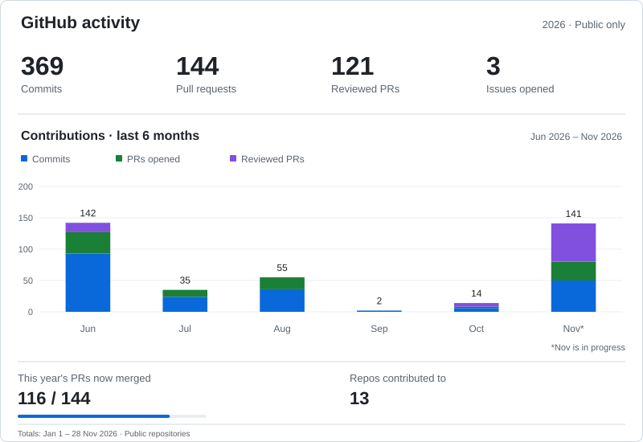

# Lightning

HUST student working on **web and mobile apps**, with projects in Java, Python and native Windows development as well.

Alongside building apps, I enjoy competitive programming and exploring data structures and algorithms.

## Technologies I've worked with

**Languages**

  &nbsp;
  &nbsp;
  &nbsp;
  &nbsp;
  &nbsp;
  &nbsp;
  

**Frameworks & runtimes**

  &nbsp;
  &nbsp;
  &nbsp;
  &nbsp;
  &nbsp;
  &nbsp;
  

**Backend & real-time** &nbsp; Express · Socket.IO · WebRTC 
**Mobile** &nbsp; Flutter · Riverpod 
**Databases** &nbsp; PostgreSQL · MySQL · MongoDB 
**Python notebooks** &nbsp; NumPy · Matplotlib · Jupyter 
**Desktop** &nbsp; JavaFX · Win32 · Media Foundation 
**Tools** &nbsp; Git · Docker · GitHub Actions

## Projects

| Project | What I work on |
| :--- | :--- |
| **[CoLearnia](https://github.com/Lightning1507/CoLearnia)** | A collaborative learning platform. Real-time communication, testing and code review as part of the team. |
| **KPI Buddy** | The Flutter app in a team task/KPI management project: employee tasks, attention items and personal skills. Source is private. |
| **[KaitenCam](https://github.com/Lightning1507/KaitenCam)** | A Windows virtual camera that mirrors webcam video, built with C++ and Media Foundation. |

## Currently working on

- **CoLearnia:** real-time session behavior and integration testing.
- **KPI Buddy:** connecting the employee mobile experience to backend APIs, with task context and personal skills.

<!-- activity:start -->
<picture>
  <source media="(prefers-color-scheme: dark) and (max-width: 600px)" srcset="assets/activity-dark-mobile-8cb68e676391.svg" />
  <source media="(max-width: 600px)" srcset="assets/activity-light-mobile-0273647b3b47.svg" />
  <source media="(prefers-color-scheme: dark)" srcset="assets/activity-dark-f90048d3d0df.svg" />
  
</picture>

Activity details and data

**This year · 2026**

| Commits | PRs | Reviewed PRs | Issues |
| :---: | :---: | :---: | :---: |
| **369** | **144** | **121** | **3** |

| Month (UTC) | Commits | PRs | Reviewed PRs |
| :--- | ---: | ---: | ---: |
| 2026-06 | 93 | 34 | 15 |
| 2026-07 | 24 | 11 | 0 |
| 2026-08 | 36 | 19 | 0 |
| 2026-09 | 2 | 0 | 0 |
| 2026-10 | 6 | 2 | 6 |
| 2026-11 (in progress) | 50 | 30 | 61 |

2026 · Public repositories · Updated 28 Nov, 10:25 UTC · [About these counts](docs/activity.md) · [Data](data/activity.json)
<!-- activity:end -->

[Pull requests](https://github.com/pulls?q=is%3Apr+author%3ALightning1507+is%3Apublic) · [Reviews](https://github.com/pulls?q=is%3Apr+reviewed-by%3ALightning1507+-author%3ALightning1507+is%3Apublic) · [Repositories](https://github.com/Lightning1507?tab=repositories)

---

❤️ [@nqocdungg](https://github.com/nqocdungg)
