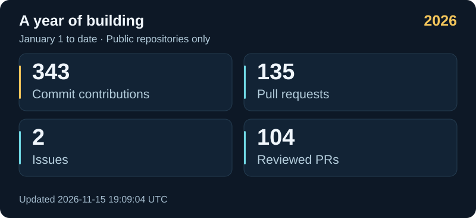

  

I’m **Lightning**, a HUST student building web and mobile applications. I work with **TypeScript and React** on the web, **Flutter and Dart** on mobile, and explore native Windows development with **C++**.

I’m interested in how an application fits together: its interface, APIs, real-time behavior, and the details that make it useful in everyday work.

### Selected work

**[CoLearnia ↗](https://github.com/Lightning1507/CoLearnia)** · Collaborative learning

A team project for online learning, shared workspaces, and real-time group discussion. My work includes real-time communication research and implementation, testing, and code review.

`TypeScript` `React` `Socket.IO` `WebRTC`

**KPI Buddy** · Employee mobile application

My mobile work within a team task and KPI management project: assigned tasks, items needing attention with supporting evidence, and personal skills across projects. Built with Flutter; source code is private.

`Flutter` `Dart` `Riverpod` `REST APIs`

**[KaitenCam ↗](https://github.com/Lightning1507/KaitenCam)** · Native Windows utility

A Windows virtual camera project that mirrors webcam video horizontally, using Media Foundation and a system tray application.

`C++` `Win32` `Media Foundation`

### On GitHub

[Pull requests](https://github.com/pulls?q=is%3Apr+author%3ALightning1507+is%3Apublic) &nbsp; / &nbsp; [Reviews](https://github.com/pulls?q=is%3Apr+reviewed-by%3ALightning1507+-author%3ALightning1507+is%3Apublic) &nbsp; / &nbsp; [Issues](https://github.com/issues?q=is%3Aissue+author%3ALightning1507+is%3Apublic) &nbsp; / &nbsp; [Repositories](https://github.com/Lightning1507?tab=repositories)

Public contributions this year · Updated daily · Reviews count reviewed PRs. [How these numbers work](docs/activity.md).
